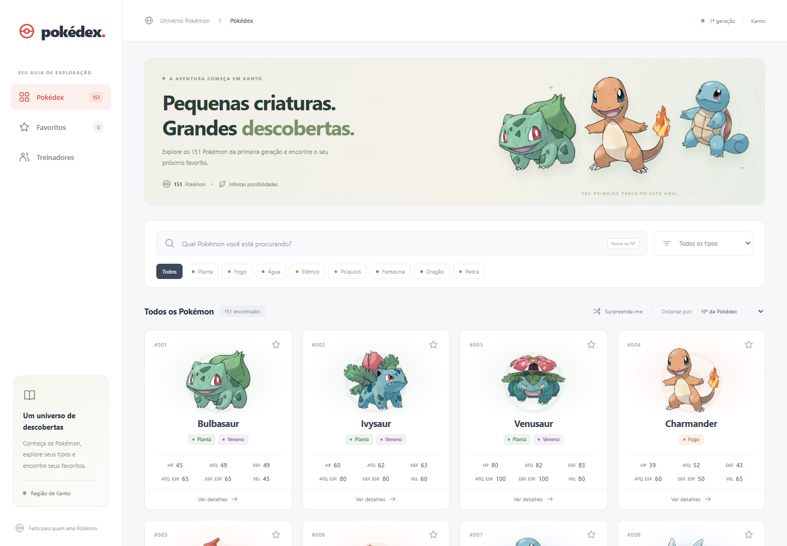

# Pokédex — Atividade 03

Aplicação de consulta dos 151 Pokémon do arquivo fornecido na atividade, construída com **React, Vite, JavaScript e CSS**. Os dados são locais: a aplicação não consulta uma API para carregar Pokémon, tipos, atributos ou treinadores.

## Executar

Pré-requisito: **Node.js 22.12 ou superior**, com npm.

Na pasta do projeto:

```bash
npm install
npm run dev
```

Abra **http://127.0.0.1:5173**. Se essa porta estiver ocupada, utilize o endereço indicado pelo Vite no terminal.

No PowerShell, se a política de execução impedir o uso de `npm.ps1`, utilize os comandos equivalentes `npm.cmd install` e `npm.cmd run dev`.

Para gerar e conferir a versão de produção:

```bash
npm run build
npm run preview
```

O preview fica normalmente em **http://127.0.0.1:4173**; confirme o endereço exibido no terminal. Os arquivos de produção são gerados em `dist/`.

## Prévia



[Ver a interface no celular](docs/pokedex-mobile.png).

## Funcionalidades

- Lista com os 151 Pokémon, mostrando ID, nome, tipos e os seis atributos: HP, ataque, defesa, ataque especial, defesa especial e velocidade.
- Pesquisa imediata por parte do nome ou ID exato, incluindo os formatos `25`, `025` e `#025`.
- Filtro pelos tipos presentes no JSON, combinado com a pesquisa e os favoritos.
- Detalhes do Pokémon selecionado com ID, nome, tipos e todos os atributos.
- Consulta dos 12 treinadores, suas insígnias e seus Pokémon relacionados no arquivo fornecido.
- Mensagem para uma busca sem resultados e opção de limpar os filtros.
- Interface responsiva, identidade visual própria, cores por tipo e barras de atributos.
- Favoritos salvos no `localStorage` do navegador.
- Ordenação por ID, nome ou qualquer um dos seis atributos; atributos em ordem decrescente.
- Seleção de um Pokémon aleatório.

## Organização

```text
pokedex/
├── docs/                   # Capturas da interface em desktop e celular
├── public/images/pokemon/  # Imagens locais dos Pokémon
├── src/
│   ├── components/         # Componentes React reutilizáveis
│   ├── data/
│   │   ├── pokedex-data.json # Arquivo original fornecido na atividade
│   │   └── pokedex.js      # Dados exportados, pesquisa e ordenação
│   ├── css/                # Estilos da aplicação e dos componentes
│   ├── App.jsx             # Estados e integração da interface
│   └── main.jsx            # Entrada do React
├── index.html
├── package.json
└── vite.config.js
```

`src/data/pokedex-data.json` é uma cópia integral do arquivo disponibilizado na atividade. Contém 151 Pokémon, 18 tipos e 12 treinadores. As associações usam `pokemonIds` nos treinadores e os identificadores dos tipos em cada Pokémon. Rótulos traduzidos na interface não alteram o JSON original.

No arquivo original, Mew possui a lista de tipos vazia. A interface o apresenta como **Sem tipo**, e esse filtro encontra Mew sem acrescentar dados ao JSON. O tipo **Sombrio** (`Dark`) está no catálogo, mas não há Pokémon associado a ele nesse arquivo; selecioná-lo exibe o estado sem resultados.

A implementação utiliza componentes funcionais, props, `useState`, `useEffect`, eventos, listas com `map()`, filtragem e estados derivados. React e React DOM compõem a interface; Vite e seu plugin React fornecem o ambiente de desenvolvimento e o build. Não são necessários banco de dados, servidor de aplicação ou bibliotecas adicionais de interface.

## Imagens

As imagens vêm do repositório público [PokeAPI/sprites](https://github.com/PokeAPI/sprites), a partir de `sprites/pokemon/other/official-artwork/{id}.png`. Estão armazenadas em `public/images/pokemon/{id}.png` e são servidas localmente. Essa fonte complementa apenas a apresentação visual; todas as informações e relações continuam vindo do JSON da atividade.

Pokémon e seus personagens pertencem aos respectivos titulares. Este projeto foi preparado para uso educacional; observe as condições de uso das imagens antes de outras formas de distribuição.

## Validação

Verificações realizadas: build de produção sem erros; 32 verificações de integridade dos dados, pesquisa, filtros e ordenação com Node.js; 13 grupos de testes de interação no Chrome. Foram conferidos os 151 cards, os 151 modais, os seis atributos de cada Pokémon, as oito ordenações, pesquisa, filtros, favoritos persistentes, os 12 treinadores e suas equipes, seleção aleatória e navegação por teclado com restauração de foco.

A versão de produção também foi conferida nas larguras de 320, 390, 768, 1024 e 1440 pixels, sem rolagem horizontal, erros JavaScript ou requisições a serviços externos.

Para conferir novamente:

```bash
npm run build
npm run preview
```

No navegador, confira:

1. A lista inicial contém todos os 151 Pokémon e exibe os seis atributos.
2. `Bulba` encontra Bulbasaur; `25`, `025` e `#025` encontram Pikachu.
3. Pesquisa, tipo e favoritos funcionam juntos; uma combinação sem resultados mostra a mensagem correspondente.
4. Os detalhes exibem o Pokémon selecionado e seus seis atributos.
5. Cada treinador mostra a quantidade de insígnias e os Pokémon associados no JSON.
6. Favoritos permanecem após recarregar a página; cada ordenação e a seleção aleatória funcionam.
7. A interface continua utilizável em desktop, tablet e smartphone, inclusive com teclado.

## Entrega

A atividade exige trabalho em dupla com **Pair Programming** e participação ativa dos dois integrantes. Os nomes e a divisão real das contribuições devem ser registrados pela dupla antes da entrega, conforme orientação do professor.

- [x] Revisar a aplicação e validar os requisitos no navegador.
- [ ] Identificar os dois integrantes e registrar suas contribuições reais.
- [ ] Publicar no GitHub o código completo, a configuração do Vite, `package.json`, o JSON, as imagens locais e este README.
- [ ] Confirmar que outra pessoa consegue executar o projeto seguindo estas instruções.
- [ ] **Cada um dos dois integrantes** deve entregar no Canvas o link do repositório no GitHub.
